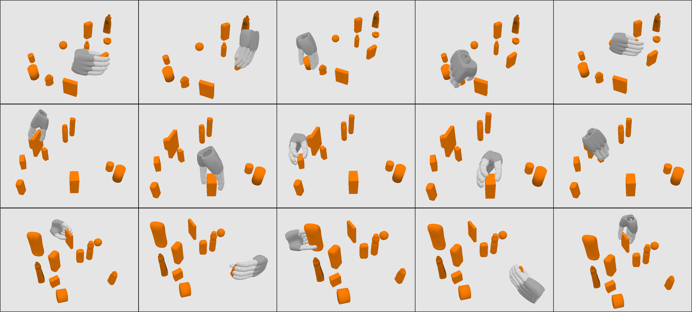

# DGS-Net: Learning Dexterous Grasps from Single-View Point Clouds via a Multi-Object Scene Dataset

## Abstract

Dexterous grasping in multi-object scenes remains a fundamental challenge for robotic manipulation, particularly under single-view perception where occlusion and incomplete geometry introduce significant uncertainty. To address this challenge, we propose DGS-Net, an end-to-end dexterous grasp prediction network that directly infers complete high-DoF grasp configurations from single-view scene point clouds without relying on explicit object reconstruction or segmentation. By explicitly modeling grasp offsets and pre-grasp configurations, DGS-Net effectively compensates for projection errors and geometric ambiguity caused by partial observations, enabling more accurate and physically consistent grasp execution. To support effective training of the proposed model, we develop an efficient two-stage dexterous grasp data generation pipeline that first synthesizes dense object-level grasps and then refines them into physically consistent scene-level grasps. Our dataset provides explicit grasp offset modeling, pre-grasp configurations, and point-cloud-level grasp semantic labels, which guide the network to focus on grasp-relevant regions, thereby enhancing the precision and robustness of grasp prediction under occluded conditions. Extensive real-world experiments demonstrate that DGS-Net achieves a grasp success rate of 79.39% and a clearance rate of 87.94% on a physical robotic platform. Moreover, compared to the baselines, our method reduces the translation error by approximately 29% and the rotation error by about 41% in grasp perturbation tests, validating its effectiveness, robustness, and generalization capability for single-view dexterous grasping in multi-object scenes. 

## Dataset Overview

Our dataset contains over 60k RGB-D images from 240 multi-object scenes, each with 5-15 randomly selected objects, captured from 256 viewpoints per scene, yielding more than 350k valid grasp instances. Each sample includes the scene point cloud, grasp center point semantic labels, dexterous hand grasp poses, pre-grasp and final joint configurations, occlusion information, and segmentation masks. In contrast to most existing datasets that provide only final grasp configurations, we additionally include pre-grasp hand poses, capturing the hand's initial state during approach. This design better reflects real-world grasping behavior and enhances sim-to-real transfer.

## Dataset Download

**Main Dataset:**  https://pan.baidu.com/s/1SL4EADnPFlTuN-PTyRcVHg?pwd=7816 Access Code: 7816

## Real and Sim Example




## Dataset Details
```
Data/
├── scenes/                         # Stage II Grasp Data
│   ├── scene_0000/
│   │   ├── rgb/                    # RGB images (256 viewpoints)
│   │   ├── depth/                  # Depth images
│   │   ├── pointcloud/             # Scene point clouds
│   │   ├── segn/                   # Segmentation masks
│   │   ├── grasp/                  # Grasp annotations
│   │   ├── cam_extrinsic.txt       # Camera extrinsic parameters for each viewpoint
│   │   ├── cam_info.txt            # Camera intrinsic parameters
│   │   ├── grasp_labels.txt        # Successful grasp poses and joint angles
│   │   ├── obj_info.txt            # Object information and metadata in the scene
│   │   └── visible_mask.txt        # Object visibility information in RGB images for each viewpoint
│   ├── scene_0001/
│   └── ...
└── grasp_labels/                   # Stage I Grasp Data
    ├── bowl/                       # Dexterous hand grasp poses for bowl objects
    │   ├── 024_bowl/               # Grasp data for 5 different scaling factors
    │   └── ...
    ├── cuboid/                     # Dexterous hand grasp poses for cuboid objects
    ├── cylinder/                   # Dexterous hand grasp poses for cylinder objects
    ├── stick/                      # Dexterous hand grasp poses for stick objects
    └── sphere/                     # Dexterous hand grasp poses for sphere objects
```

